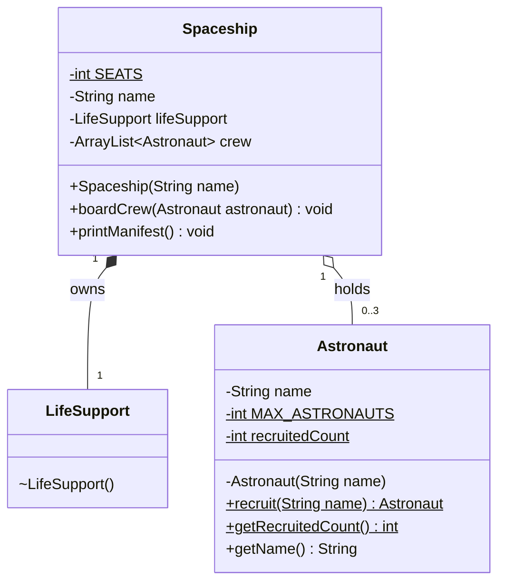

# UML: LimitedCrewMission

`$` = static member, `~` = package-private.

- Filled diamond (`*--`): composition. `Spaceship` creates and owns its `LifeSupport`.
- Empty diamond (`o--`): aggregation. `Spaceship` holds `Astronaut` objects created outside.javac --release 17 *.java
  java Main