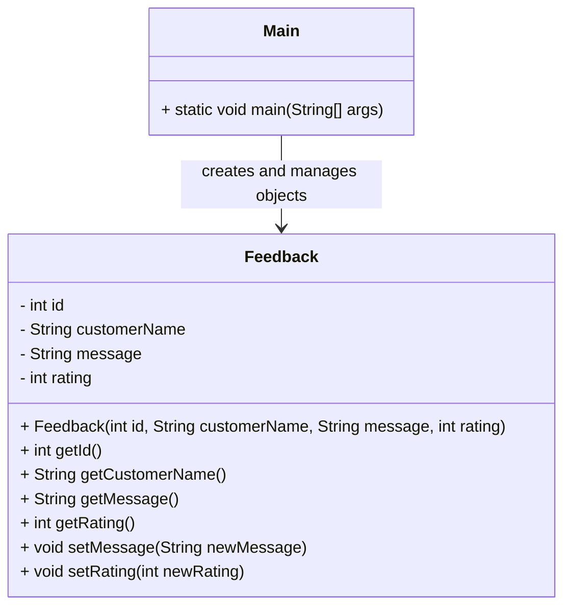

# Feedback Encapsulation UML

## Project Overview
This project demonstrates the Java concept of encapsulation. The `Feedback` class stores sensitive data in private fields and exposes controlled access through getters and setters. The `Main` class creates objects and tests valid and invalid updates.

## Class Diagram



## Explanation of the Design

### Feedback class
The `Feedback` class contains four private variables:
- `id`
- `customerName`
- `message`
- `rating`

These variables are hidden from direct outside access. That means other classes cannot change them without using the provided methods.

### Constructor
The constructor initializes the object with a valid ID, customer name, message, and rating. It also calls `changeMessage(message)` and `changeRating(rating)`. In the current code, the constructor sets `this.rating = 1` before validation and then validates the actual rating through the setter-style logic.

### Getters
The class includes getters such as:
- `getId()`
- `getCustomerName()`
- `getMessage()`
- `getRating()`

These methods allow read-only access to the private data.

### Setters
The class includes setter methods:
- `setMessage(String newMessage)`
- `setRating(int newRating)`

These methods validate the input before updating the object:
- `setMessage` rejects empty or blank messages.
- `setRating` accepts only values from 1 to 5.

This protects the object from invalid data.

## Relationship Between the Classes
The `Main` class creates two `Feedback` objects:
- `review1`
- `review2`

It then tries invalid updates and follows with valid ones.

Example:
- `review1.setRating(9)` is rejected because the accepted range is only 1 to 5.
- `review1.setMessage("")` is rejected because empty messages are not allowed.
- `review2.setRating(3)` succeeds.
- `review2.setMessage("The service was helpful")` succeeds.

## Encapsulation Benefits
Encapsulation is important because it:
- protects the internal state of the object,
- prevents invalid values from entering the class,
- makes the code easier to maintain,
- improves code readability and safety.

## Example Output

```text
Feedback 1
ID: 1
Name: Aisha
Message: Great service
Rating: 5

Feedback 2
ID: 2
Name: Sara
Message: The service was helpful
Rating: 3
```

## Summary
This project shows how encapsulation helps control how an object's data is accessed and modified. The `Feedback` class protects its fields and validates data before changing them, which keeps the program more stable and reliable.
