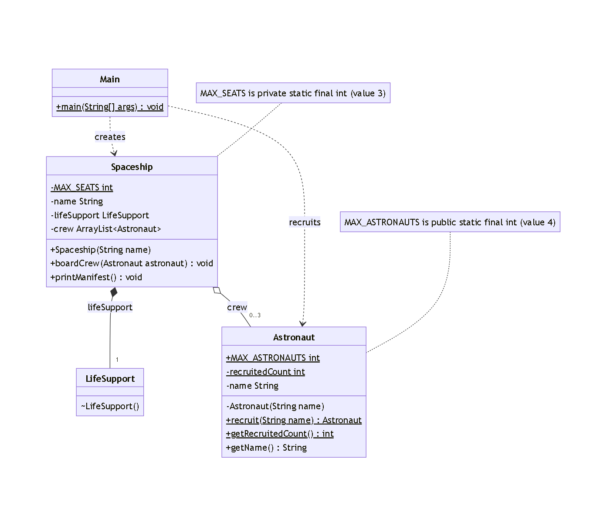

# Limited Crew Mission

## Overview

A Java 17 practice project that demonstrates static counters, controlled object creation, composition, and aggregation.

The program simulates a space agency that can recruit a maximum of four astronauts and spaceships that can carry up to three astronauts.

## Concepts Practised

- Static fields and methods
- Private constructors
- Controlled object creation
- ArrayList
- Composition
- Aggregation
- Object references
- Null handling
- Loops and conditional statements

## Project Structure

```text
LimitedCrewMission/
├── Astronaut.java
├── LifeSupport.java
├── Spaceship.java
├── Main.java
├── README.md
└── LimitedCrewMission-UML.png
```

## Class Responsibilities

### Astronaut

- Stores each astronaut's name.
- Uses a static counter to track recruited astronauts.
- Limits recruitment to four objects.
- Uses a private constructor and a static `recruit()` method.

### LifeSupport

- Represents the life support system owned by a spaceship.
- Has a package-private constructor.
- Prints a message when installed.

### Spaceship

- Stores the spaceship name.
- Creates its own LifeSupport object through composition.
- Holds astronauts through aggregation.
- Limits its crew to three seats.
- Prints the crew manifest.

### Main

- Recruits five astronauts.
- Builds Falcon and Comet.
- Tests recruitment and seating limits.
- Demonstrates that astronauts can exist independently of a spaceship.

## Composition and Aggregation

### Composition

A Spaceship creates and owns its LifeSupport object inside its constructor.

### Aggregation

Astronaut objects are created independently using `Astronaut.recruit()` and passed to `Spaceship.boardCrew()`.

The same astronaut can join another spaceship.

## UML Class Diagram



## How to Compile and Run

Requirements: Java 17 or later.

Open the terminal in this folder.

Compile:

```powershell
javac --release 17 Astronaut.java LifeSupport.java Spaceship.java Main.java
```

Run:

```powershell
java Main
```

## Expected Behaviour

- A maximum of four astronauts can be recruited.
- The fifth recruitment attempt is rejected.
- Each spaceship has three seats.
- A spaceship creates its own life support system.
- Astronauts can move between spaceships.
- The recruitment counter remains four.

## Author

Almuatasam

## Related Issue

[GitHub Issue #453](https://github.com/CodelineAtyab/RedStackExperimentProject/issues/453)
