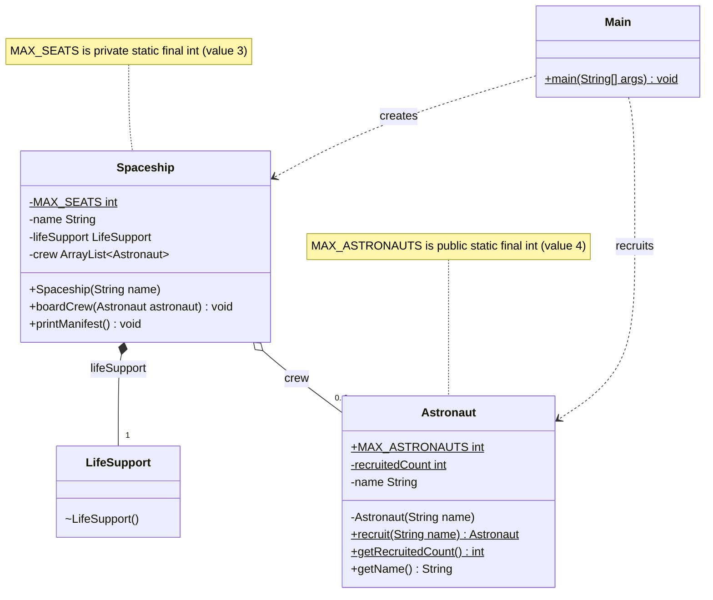

# Limited Crew Mission - UML Class Diagram

## How to read it

| Notation | Meaning |
|----------|---------|
| Underlined member (`$`) | `static` field or method |
| `*--` (filled diamond) | Composition: `Spaceship` creates and owns its `LifeSupport` |
| `o--` (empty diamond) | Aggregation: `Spaceship` only holds references to `Astronaut` objects created elsewhere |
| `..>` (dashed arrow) | `Main` depends on / uses the class |
| `+` / `-` / `~` | public / private / package-private |

## The three relationships

- **Spaceship - LifeSupport (composition):** the ship builds its own `LifeSupport` in its constructor, and the constructor is package-private. The life support has no life outside the ship.
- **Spaceship - Astronaut (aggregation):** astronauts come from `Astronaut.recruit()` and are passed to `boardCrew()`. They exist before the ship and survive it.
- **Astronaut (static):** `MAX_ASTRONAUTS` and `recruitedCount` belong to the class. Together with the private constructor, they cap the number of objects at four.
