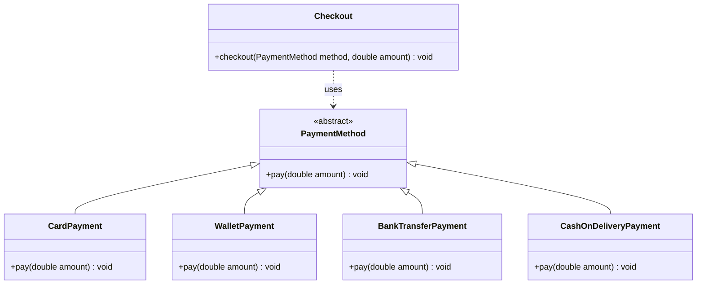

# Open/Closed Payments

## Description

A small Java program that processes a checkout using different payment methods. `Checkout` takes any `PaymentMethod`, prints the amount, asks the payment method to pay, and then prints a thank-you message. `Main` runs four payment methods (card, wallet, bank transfer and cash on delivery) through the same `Checkout` with an amount of OMR 25.00.

Cash on delivery was added without changing `Checkout.java`.

## Concepts Practiced

- **Abstract classes:** `PaymentMethod` defines what every payment method must do without saying how.
- **Inheritance:** each payment class extends `PaymentMethod`.
- **Overriding:** each subclass provides its own `pay(double amount)` using `@Override`.
- **Polymorphism:** `Checkout` calls `method.pay(amount)` on a `PaymentMethod`, and Java runs the version belonging to the real object.
- **Open/Closed Principle:** the program is open for extension (new payment classes) but closed for modification (`Checkout` stays unchanged).

## Classes

| Class | Responsibility |
|-------|----------------|
| `PaymentMethod` | Abstract parent class. Declares `abstract void pay(double amount)`. |
| `CardPayment` | Pays by card. |
| `WalletPayment` | Pays from a wallet. |
| `BankTransferPayment` | Pays by bank transfer. |
| `CashOnDeliveryPayment` | Tells the customer to pay in cash when the order arrives. |
| `Checkout` | Runs a checkout for any `PaymentMethod`: prints the amount, calls `pay`, prints "Thank you!". |
| `Main` | Puts the four payment methods in an `ArrayList<PaymentMethod>` and checks out each one with 25.0. |

## How to Compile and Run

From inside this folder:

```bash
javac *.java
java Main
```

## Expected Output

```
Checkout: OMR 25.00
Paid OMR 25.00 by card
Thank you!
Checkout: OMR 25.00
Paid OMR 25.00 from wallet
Thank you!
Checkout: OMR 25.00
Paid OMR 25.00 by bank transfer
Thank you!
Checkout: OMR 25.00
Pay OMR 25.00 in cash when the order arrives
Thank you!
```

## UML Diagram



`Checkout` uses `PaymentMethod`. It does not inherit from it.
