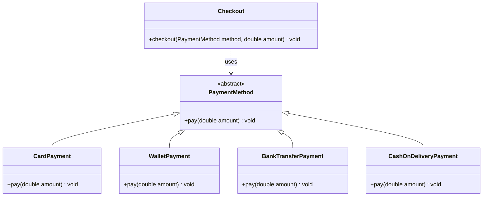

# Open/Closed Payments — UML (Part A)

- **Inheritance (solid line, hollow arrow):** `CardPayment`, `WalletPayment`, `BankTransferPayment` and `CashOnDeliveryPayment` each extend `PaymentMethod` and override `pay`.
- **Dependency (dashed arrow):** `Checkout` uses `PaymentMethod`. It does not inherit from it, and it never refers to a specific payment class.
