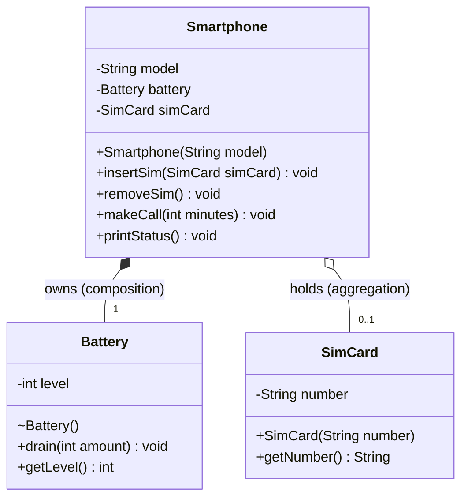

# Phone Composition and Aggregation

## Description

A small Java program that models a smartphone. Each `Smartphone` has a model name, a `Battery` it creates itself, and an optional `SimCard` that can be inserted and removed. `Main` creates one SIM card, uses it in `PhoneA`, removes it, then inserts the same SIM into `PhoneB`. This shows that the SIM object survives being removed from a phone.

Each call minute drains 2% of the battery. A phone with no SIM cannot make calls.

## Concepts Practiced

- Composition (strong "has-a" relationship)
- Aggregation (weak "has-a" relationship)
- Encapsulation with private fields and public methods
- Package-private constructors
- Object references and `null`
- UML class diagrams

## Class Responsibilities

| Class | Responsibility |
|-------|----------------|
| `Smartphone` | Stores the model, creates and owns its `Battery`, holds an optional `SimCard`. Inserts and removes the SIM, makes calls (needs a SIM, drains 2% per minute) and prints its status. |
| `Battery` | Keeps the charge level, starting at 100. `drain(int)` lowers it (never below 0) and `getLevel()` returns it. Its constructor is package-private so only code in the same package, such as `Smartphone`, can create one. |
| `SimCard` | Stores a phone number set at construction. `getNumber()` returns it. The number cannot be changed. |
| `Main` | Runs the demo: creates one SIM and two phones, then moves the SIM from one phone to the other. |

## Composition vs Aggregation

**Composition (`Smartphone` and `Battery`):** the phone creates its battery with `new Battery()` in its constructor and owns it. The battery is never shared or passed in from outside, and it lives and dies with the phone.

**Aggregation (`Smartphone` and `SimCard`):** `Main` creates the SIM and passes it to a phone. The phone only holds a reference. `removeSim()` sets that reference to `null` and does not destroy the SIM, so the same object can be inserted into another phone.

## Compile and Run

From inside this folder:

```
javac *.java
java Main
```

## Expected Output

```
PhoneA called for 10 min using 99112233, battery 80%
PhoneA | Battery: 80% | SIM: 99112233
PhoneA: no SIM card
PhoneB called for 5 min using 99112233, battery 90%
PhoneB | Battery: 90% | SIM: 99112233
PhoneA | Battery: 80% | SIM: none
SIM still exists: 99112233
```

## UML Diagram



- **Filled diamond:** composition, `Smartphone` owns `Battery`.
- **Empty diamond:** aggregation, `Smartphone` holds `SimCard`.
- **Visibility:** `-` private, `+` public, `~` package-private.
