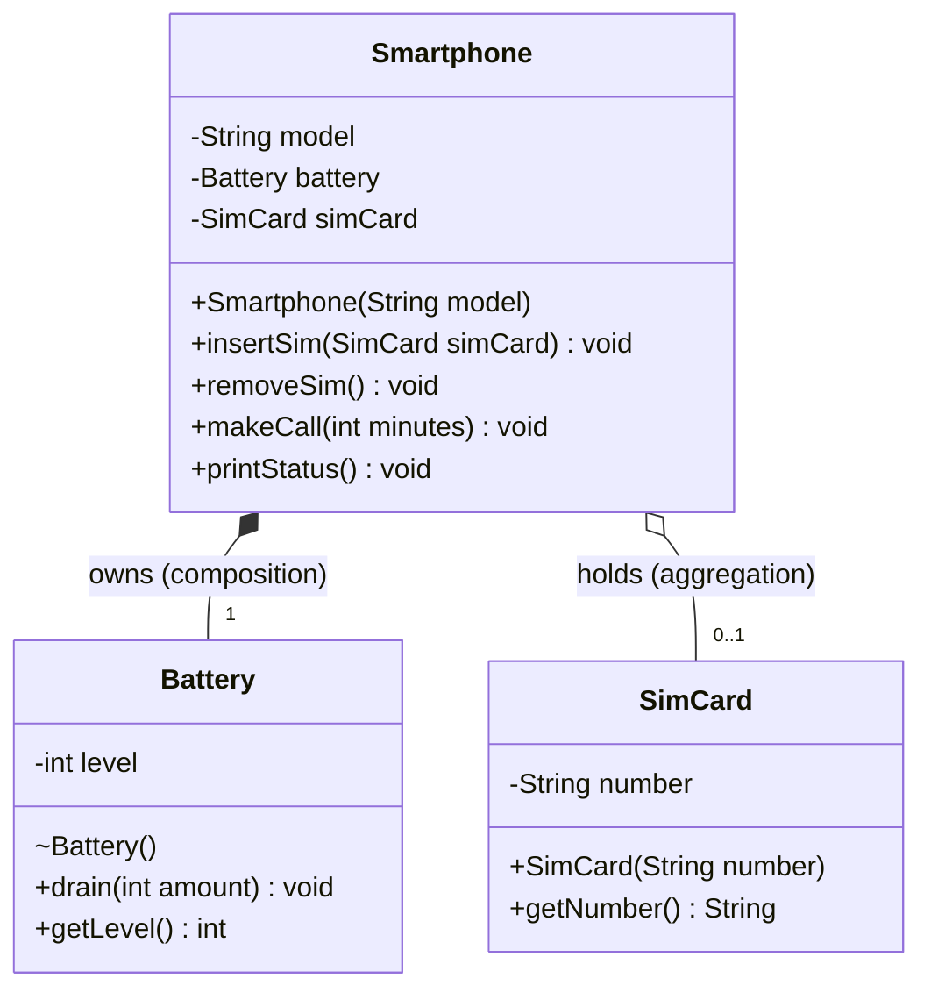

# Part B UML: Smartphone, Battery, SimCard

- **Filled diamond (composition):** `Smartphone` creates and owns its `Battery`. It cannot exist without the phone.
- **Empty diamond (aggregation):** `Smartphone` only holds a reference to a `SimCard` created elsewhere. The SIM can be removed and moved to another phone.
- **Visibility:** `-` private, `+` public, `~` package-private (the `Battery` constructor).
