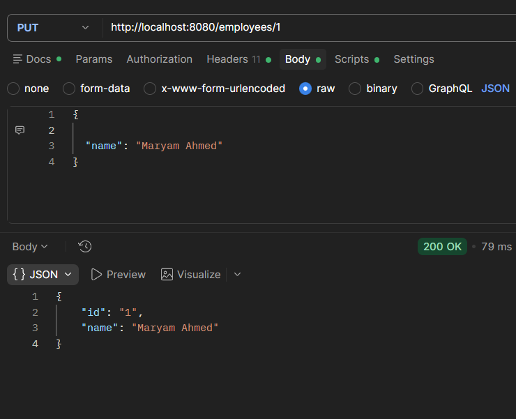
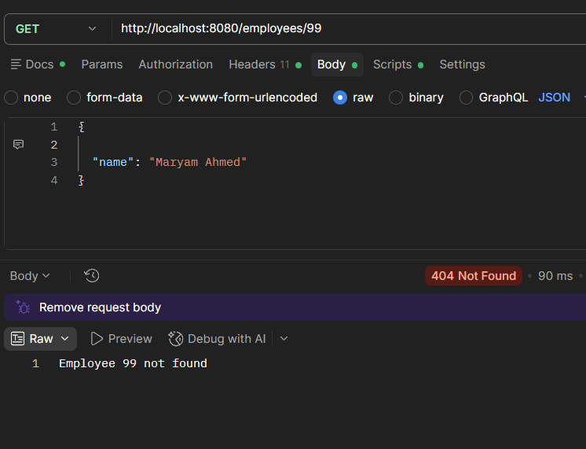
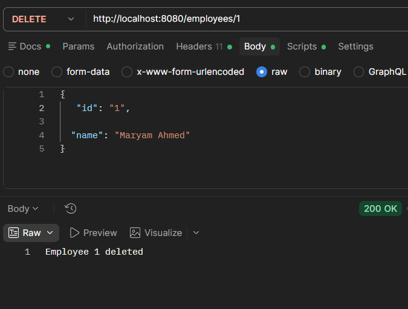
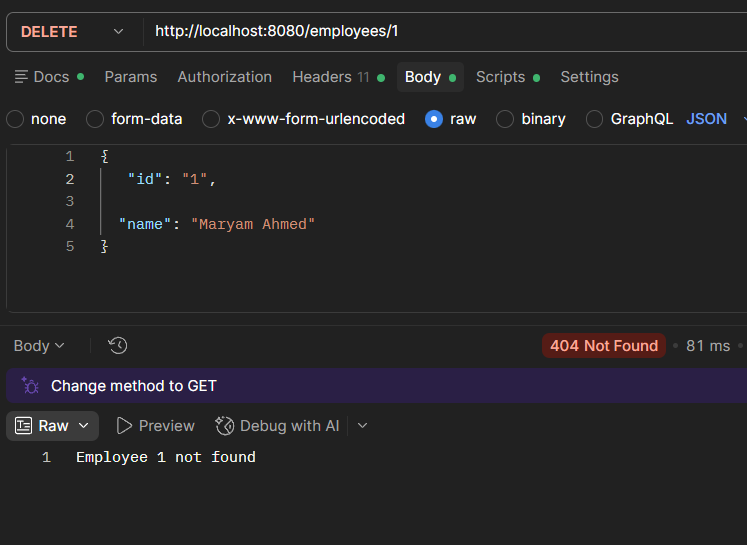
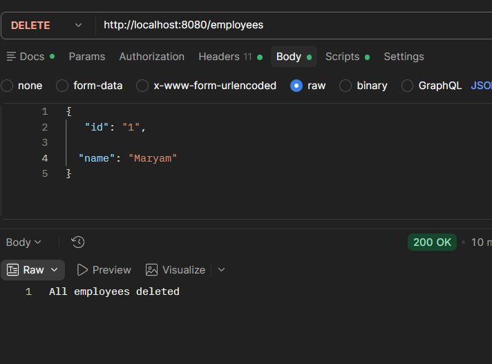
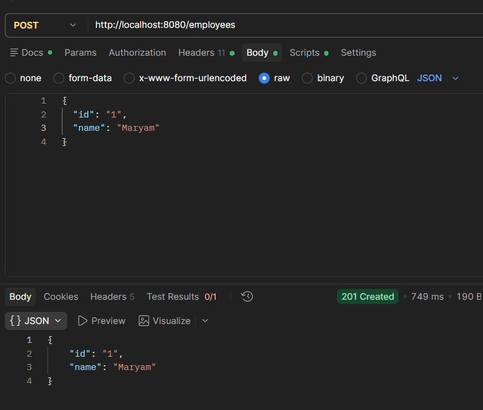
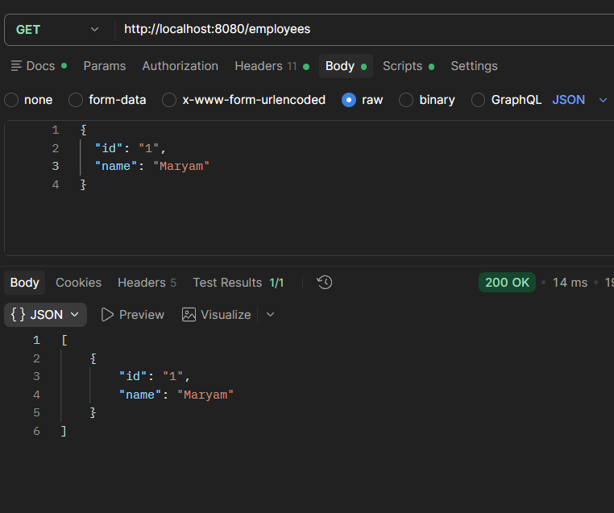
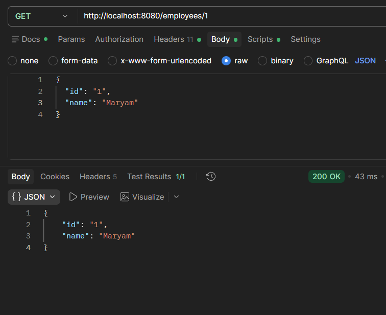

diff between 201 and 202:

201 >>Created>>> use it when server created resource is successfully
202 >>Accepted>> use when server request accepted but processing of request not completed
https://www.one.com/en-gb/academy/http-200/

.............................................................................................

ResponseEntity>>>allows the controller to return a response body together with an HTTP status code.
filter>>>>> select elements that match a specific condition.
map>>>>transforms each element into another value.

...............................................................................................

No blocks
Understanding how the Service and Controller work together
especially handling different return types and HTTP status codes.

...............................................................................................

